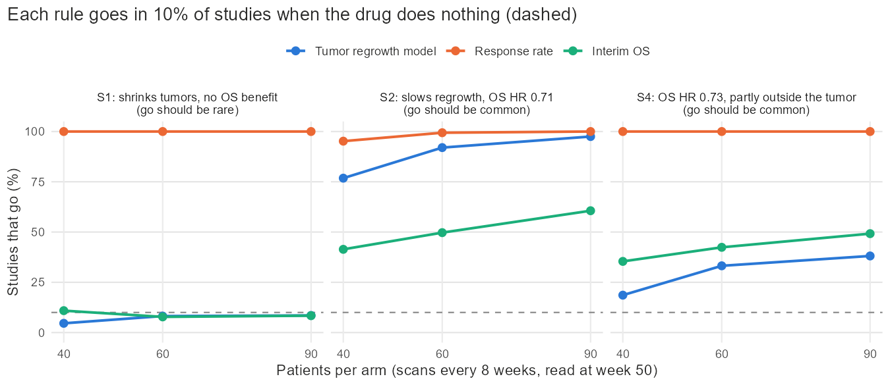

# Oncology PK/PD decisions by simulation

A clinical pharmacology team turns sparse phase 2 data into decisions: a population PK model, the dose to carry forward, whether to go to phase 3, and a new patient's risk of a serious side effect. This project simulates a fictional oral kinase inhibitor so that each of those steps can be checked against a known truth, in R with nlmixr2.

The plan and its rules were committed before any estimator was run ([docs/design.md](docs/design.md)); the results are read against those rules in [docs/readout.md](docs/readout.md). 11 of the 12 rules were met; the one that was not is explained there.

## Results

- **Samples below the LLOQ (population PK).** With 18% of concentrations below the limit, the censored likelihood (Beal's M3) kept the mean bias of CL/F and V/F within 2% over 20 studies (nlmixr2, FOCEi). Dropping those samples biased V/F by +7.8% and ka by +10.5%; setting them to LLOQ/2 biased ka by -5.9%.
- **Exposure-response and the dose.** Albumin raises clearance and lowers the response rate, so exposure is confounded with prognosis. With a true gain of 7.1 points from 100 to 200 mg, an exposure-response model without albumin estimated 11.6 points and chose 200 mg in 61% of 2,000 studies; with albumin it estimated 7.2 and chose 200 mg in 32%, with a third less spread than the randomized arm comparison.
- **Tumor dynamics and go/no-go.** A tumor growth inhibition model (Stein) was fitted by SAEM to a historical study and its regrowth rate linked to survival. In 45,000 simulated phase 2 studies, at a 10% go rate for an inactive drug, a response-rate rule went for a drug that shrinks tumors without helping survival in 100% of studies; the regrowth-rate rule went in 4-8%. For a drug that slows regrowth (survival hazard ratio 0.71), the regrowth rule went in 92% of studies at 60 patients per arm against 50% for an interim survival analysis.
- **Scan schedule.** Against the plan's prediction, 12-week scans gave the regrowth rule more power than 6-week scans (95% vs 86%). Frequent scans call progression sooner and scanning stops there, so tumors are followed for less time; when scanning continued after progression, the interval hardly mattered.
- **Adverse-event risk at a new dose.** Predicting grade 3+ adverse-event risk for new patients at 400 mg, above the studied 100 and 200 mg, the exposure-response model built on the population PK fit had a median RMSE of 9.1 points; XGBoost on dose and covariates had 24.9, because trees stay flat beyond the training doses.



More figures: [BLQ bias](figures/blq_bias.png), [exposure-response gain](figures/er_gain.png), [adverse-event risk](figures/ae_risk.png).

## How to run

R 4.4 with nlmixr2, rxode2, xgboost, survival, statmod and the tidyverse. From the project folder, in order:

```
Rscript scripts/00_truth.R          # truths from large simulated populations
Rscript scripts/01_check.R          # code checks
Rscript scripts/02_er.R             # Part A2, exposure-response (1 min)
Rscript scripts/03_poppk.R          # Part A1, 60 population PK fits (about 20 min on 4 cores)
Rscript scripts/04_historical.R     # Part B0, tumor model on the historical study
Rscript scripts/05_decisions.R      # Part B, 45,000 phase 2 studies (about 20 min on 8 cores)
Rscript scripts/08_ae_ml.R          # Part C, adverse-event risk (about 15 min on 4 cores)
Rscript scripts/06_verdicts.R       # rules, summary tables
Rscript scripts/07_figures.R
Rscript scripts/09_posthoc_scans.R  # post hoc check of the scan interval
```

`PKPD_WORKERS` sets the number of parallel workers. Unit tests: `Rscript -e "testthat::test_file('tests/test_core.R')"` from the `tests` folder.

## Layout

- `R/pk.R` population PK simulation, BLQ handling and the nlmixr2 model; `R/er.R` exposure-response; `R/tgi.R` tumor model, survival, grid estimation of regrowth rates and the decision metrics; `R/tgi_fit.R` the nlmixr2 tumor model; `R/ae.R` adverse-event risk models.
- `scripts/` the steps above; `results/` every table the readout cites; `figures/`; `docs/` plan and readout.

Versions used: R 4.4.3, nlmixr2 5.0.0 (nlmixr2est 5.0.2, rxode2 5.0.2), xgboost 3.2.1.1, survival 3.8-3, statmod 1.5.1, dplyr 1.1.4, ggplot2 4.0.1, testthat 3.2.3.

## References

- Beal SL. Ways to fit a PK model with some data below the quantification limit. J Pharmacokinet Pharmacodyn. 2001;28(5):481-504.
- Stein WD, Figg WD, Dahut W, et al. Tumor growth rates derived from data for patients in a clinical trial correlate strongly with patient survival. Oncologist. 2008;13(10):1046-1054.
- Claret L, Girard P, Hoff PM, et al. Model-based prediction of phase III overall survival in colorectal cancer on the basis of phase II tumor dynamics. J Clin Oncol. 2009;27(25):4103-4108.
- Dai HI, Vugmeyster Y, Mangal N. Characterizing exposure-response relationship for therapeutic monoclonal antibodies in immuno-oncology and beyond: challenges, perspectives, and prospects. Clin Pharmacol Ther. 2020;108(6):1156-1170.
- Fidler M, Wilkins JJ, Hooijmaijers R, et al. Nonlinear mixed-effects model development and simulation using nlmixr and related R open-source packages. CPT Pharmacometrics Syst Pharmacol. 2019;8(9):621-633.

## License

The code is under the MIT license.

Can Zhang, zhan8639@umn.edu
